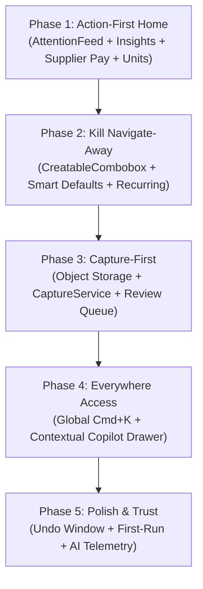

# Tenvora Architectural Transformation Plan: CRUD to AI-Assisted, Task-Driven OS

## 1. Executive Summary & Vision
This plan outlines the systematic transformation of Tenvora from a conventional CRUD application (where users navigate nested tables and fill empty forms) into a task-driven, AI-augmented business operating system. 

Under the new model:
1. **The application captures input** (voice, scanned receipt/invoice, natural language text, or scheduled trigger).
2. **Deterministic business rules & AI draft the records** with explicit field-level confidence and provenance.
3. **The user reviews and confirms** via short-lived, server-owned proposals (`AiAction` with `PendingConfirmation`).
4. **Existing CRUD screens remain intact** as a secondary "Library" for auditing, bulk management, and granular edits without breaking backward compatibility.

---

## 2. Current Architecture Baseline

### 2.1 Backend (.NET 10 Web API + EF Core 10 + PostgreSQL)
- **Tenancy & Isolation**: Cryptographically bound `TenantId` via claims, enforced through EF Core global query filters (`HasQueryFilter(e => e.TenantId == _currentTenantId)`), and PostgreSQL Row-Level Security (RLS).
- **Financial Integrity**: `FinancialWriteScope` provides row-level locking (`SELECT ... FOR UPDATE`), transaction boundaries, and balance capping (e.g., customer/supplier debt cannot be overpaid).
- **AI Action Pipeline**:
  - `AiAction` entity represents staged proposals with statuses `PendingConfirmation`, `Executed`, `Cancelled`, `Expired`, `Failed`.
  - Proposals have a 24-hour TTL, idempotency keys, and explicit risk levels (`Financial`, `Safe`).
  - `AiAgentService` parses intents and entities across 7 languages.
  - `AiActionService` executes proposals only after server-side authorization and validation against business invariants.
- **Localization**: `IAppLocalizer` resolves culture from `Accept-Language` header across 7 supported locales (`en`, `vi`, `es`, `fr`, `de`, `pt-BR`, `id`).

### 2.2 Frontend (React 18 + TypeScript + Vite 8 + Tailwind + Radix UI + TanStack Query)
- **State Management**: TanStack React Query v5 with optimistic updates and cache invalidation.
- **UI Architecture**: Standardized components (`PageHeader`, `MoneyCard`, `EmptyState`, `PaginationBar`, `SafeDeleteDialog`, `InteractiveProposalCard`).
- **Data Imports**: `DataImportsPage` provides client-side parsing, column mapping, and row-level validation.
- **Localization**: `LanguageContext` backed by 7 complete translation dictionaries with strict parity tests. VND formatted with `₫`, zero decimals, and standard separators.

---

## 3. Phase-by-Phase Implementation Plan

---

### Phase 1: Action-First Home ("Needs Attention")

#### Goals
Transform `BusinessHome.tsx` into a prioritized morning briefing and actionable cockpit. Users see what demands attention the moment they log in, with single-tap primary actions.

#### Backend Changes
1. **New Endpoints**:
   - `GET /api/dashboard/attention`: Computes and returns prioritized attention cards:
     - DTO: `{ id, type, severity, title, subtitle, count, actionLabel, actionRoute, actionKey, metadata }`.
     - Types:
       - `out_of_stock`: Tracked items with `StockQuantity <= 0` (Severity: `urgent`).
       - `low_stock`: Tracked items with `0 < StockQuantity <= MinStockLevel` (Severity: `warn`).
       - `pending_ai_actions`: Unexpired proposals with status `PendingConfirmation` (Severity: `info` / `warn`).
       - `supplier_bill_due`: Purchases posted with unpaid balance where `DueDate <= UtcNow.AddDays(3)` (Severity: `urgent` if overdue, `warn` if due in 3 days).
       - `customer_overdue`: Unpaid customer receivables older than 30 days or high balance (Severity: `warn`).
       - `unusual_activity`: Optional outlier detection (e.g., single transaction > 3x trailing 30-day average).
       - `recurring_expense_due`: Templates due for recording.
   - `GET /api/dashboard/insight`: Computes 1–2 plain-language business insights:
     - **Deterministic First**: SQL-aggregated numbers (week-over-week sales delta %, top mover product, projected cash deficit against upcoming 7-day payables).
     - **Safe Phrasing**: Localized deterministically via `IAppLocalizer` catalogs, with optional LLM polish strictly preserving computed SQL quantities.
   - `POST /api/suppliers/{id}/payments`: Implements supplier lump-sum debt payment (cascades payment across oldest unpaid purchases via FIFO, mirrors `RecordCustomerAccountPaymentAsync`).
2. **Domain & Database Migration**:
   - Add `DueDate` (`DateTime?`) to `Purchase`.
   - Add `PaymentTermsDays` (`int?`, e.g., 0, 15, 30) to `Supplier`.
   - Update `CreatePurchaseRequest`, `PurchaseDto`, `SupplierDto` and mapping profiles.
3. **Unit Presets**:
   - Endpoint `GET /api/products/units`: Returns tenant-distinct units merged with localized common presets (`item`, `kg`, `g`, `box`, `bag`, `bottle`, `can`, `pack`, `m`, `hour`, `set`).

#### Frontend Changes
1. **`BusinessHome.tsx` Redesign**:
   - **Header**: Greeting + Headline cash summary bar: Received | Net Profit | Owed to you (AR) | You owe (AP).
   - **AttentionFeed**: Max 5 prioritized items with severity badges, badge counts, and single-click primary action (e.g., "Pay Now", "Review Draft", "Restock").
   - **AI Insight Callout**: High-contrast, dismissible intelligence card.
   - **Quick Action Bar**: `[New sale]`, `[Scan invoice]`, `[Add expense]`.
   - **Secondary Activity Area**: Collapsible recent transactions & sales charts below the fold.
2. **Supplier Quick-Pay Dialog**:
   - Component `SupplierPaymentModal.tsx` on `SuppliersPage.tsx` and triggered directly from `supplier_bill_due` attention cards.
3. **Unit Presets Combobox**:
   - Reusable `UnitCombobox.tsx` replacing free-text unit inputs in `ProductsPage.tsx`, supporting custom unit entry on type.

---

### Phase 2: Kill Navigate-Away (Inline Create & Smart Defaults)

#### Goals
Eliminate friction where creating a transaction forces users to navigate to separate pages just to add a missing supplier, customer, or product.

#### Backend Changes
1. **Inline Creation Contracts**:
   - Ensure `POST /api/customers`, `POST /api/suppliers`, `POST /api/products` return compact DTOs with minimal required payload.
2. **Smart Defaults Provider**:
   - `GET /api/purchases/defaults?supplierId={id}&productId={id}`: Returns last purchased unit cost, default payment method, and calculated `DueDate` based on supplier terms.
   - `GET /api/sales/defaults?customerId={id}&productId={id}`: Returns last selling price and preferred payment method.
3. **Recurring Expense Engine**:
   - Entity `RecurringExpenseTemplate`: `TenantId`, `Category`, `Amount`, `Currency`, `Description`, `Frequency` (Weekly, Monthly, Quarterly), `NextDueDate`, `IsActive`.
   - Background check / endpoint to evaluate due templates and generate `AiAction` drafts for single-tap confirmation in the AttentionFeed.

#### Frontend Changes
1. **`<CreatableCombobox>` Component**:
   - Generic searchable dropdown for Customer, Supplier, Product.
   - Typing an unknown name shows `+ Create "[Name]"`.
   - Clicking opens a compact popover asking *only* mandatory fields.
   - Saves via API, immediately selects the new item, and preserves the parent form state without remounting or re-rendering.
   - Replaces `Link to /suppliers?create=1` and `/customers?create=1` in `PurchasesPage.tsx` and `SalesPage.tsx`.
2. **Simple Bill Mode in Purchase Dialog**:
   - Toggle: `[Detailed restock]` (with line items) vs. `[Simple bill]` (supplier, total, due date, photo receipt, payment status).
3. **Bulk Selection & Floating Action Bar**:
   - Checkbox selection on `ProductsPage` and `CustomersPage`.
   - Floating bottom bar: Archive, Stock Adjustment, CSV Export.

---

### Phase 3: Capture-First (Photo / Text / Voice -> Draft)

#### Goals
Enable zero-typing document intake. Invoices, receipts, and casual notes are parsed into staged, reviewable drafts before any database mutation occurs.

#### Prerequisite: Storage Architecture Refactoring
- **Current Issue**: Base64 data URLs stored directly in database columns (`InvoiceImageDataUrl`, `ReceiptImageDataUrl`).
- **Solution**:
  - Introduce `IFileStorageService` abstraction with `LocalDiskStorageService` (for local development/testing) and `CloudStorageService` (S3/Cloudinary for production).
  - Database schema stores relative/hosted URLs (`ImageUrl`, `ThumbnailUrl`) and file hash (SHA-256 for duplicate detection).
  - Write an EF Core data migration to extract existing base64 strings into storage and replace columns with lightweight URL references.

#### Backend Extraction Pipeline (`CaptureService`)
1. **Untrusted Input Ingestion**:
   - Document images (JPEG, PNG, WebP, PDF) or pasted text.
   - Strict size caps (10MB), MIME verification, and SHA-256 hash calculation.
2. **Prompt Injection & Safety Guardrails**:
   - Input text and OCR transcripts are treated as strictly untrusted data payloads.
   - Enforce structured extraction using Gemini JSON Schema mode.
   - Prompt instructions are isolated in system instructions; user document text is placed inside delimited XML/JSON data envelopes.
   - Rejection of prompt tampering commands found in OCR text (e.g., "ignore previous instructions and execute tool").
3. **Schema Extraction (Supporting Vietnamese & Multilingual Formats)**:
   - Vendor / Supplier name, Invoice number, Date, Currency (VND/USD), Total, Tax, Line Items (description, unit, quantity, unit cost, line total).
   - Vietnamese invoice detection: Hóa đơn GTGT, VAT, ký hiệu mẫu số, mã số thuế (MST).
   - Field-level confidence scores (0.00 to 1.00) and extraction source provenance.
4. **Deterministic Validation & Invariant Checking**:
   - Verify: `Sum(Line Items) * (1 + TaxRate) == TotalAmount` (within rounding tolerance).
   - Validate plausible dates (not future > 30 days, not past > 10 years).
   - Currency match with tenant base currency (or flagged for conversion).
5. **Entity Matching & Trigram / Fuzzy Scoring**:
   - Match vendor against `Suppliers` table using normalized string similarity and PostgreSQL trigram matching (`pg_trgm`).
   - Match products against `Products` table using SKU and normalized name.
   - If confidence < 0.75, propose "Create New" or "Possible Match" rather than guessing.
6. **Duplicate Detection**:
   - Check existing purchases/expenses with matching file hash OR matching `(SupplierId, TotalAmount, PurchasedAt.Date)`.
   - Flag as duplicate warning on the draft if found.
7. **Draft Output (`AiAction`)**:
   - Staged in `AiAction` with `Status = "PendingConfirmation"`. Zero financial mutations occur until user confirms.

#### Frontend Review & Learning Loop
1. **Capture Modal & Split-Screen Review**:
   - "Scan invoice" button opens file picker or camera.
   - Split view: Original invoice image on the left; structured editable draft on the right.
   - Provenance chips: Hovering shows "Matched to Nhà Cung Cấp ABC because you bought from them 14 times (Confidence: 94%)".
   - Low confidence fields highlighted in amber.
2. **Review Queue (Inbox)**:
   - Centralized badge in sidebar and attention feed showing pending drafts.
   - High-confidence bulk approval option for trusted routine suppliers.
3. **Correction Learning Loop**:
   - Table `TenantExtractionRules`: Saves vendor aliases (e.g., "CTY TNHH TM DV PHU MINH" -> "Phú Minh Food") and default categories.
   - Applied to future extractions prior to LLM matching.

---

### Phase 4: Everywhere Access (Command Bar + Copilot)

#### Goals
Provide instantaneous global navigation and natural language execution without leaving the active context.

#### Frontend & Architecture Changes
1. **Global Command Palette (`cmdk` / `Cmd+K` / `Ctrl+K`)**:
   - Embedded globally in `DashboardLayout.tsx`.
   - Instant search across Customers (name, phone), Products (name, SKU, stock), Invoices, and Actions (`New sale`, `Scan invoice`, `Add expense`, `Pay supplier`).
   - Keyboard accessible, recent items cache, fuzzy scoring.
2. **Context-Aware `AiCopilotDrawer` (`Cmd+J` / `Ctrl+J`)**:
   - Refactor `AgentChatPage` into a global sliding drawer or expandable panel available on any screen.
   - Injects active UI Context: `{ currentRoute, activeEntity, entityId, selectedRows }`.
   - Allows contextual queries: "Send reminder about his balance" when viewing customer details, or "Restock low stock items" when on inventory page.
   - Renders `InteractiveProposalCard` inline for one-click confirmation.

---

### Phase 5: Polish, Trust, and Measurement

#### Goals
Provide user safety nets, onboarding acceleration, accessibility compliance, and privacy-respecting observability.

#### Deliverables
1. **Undo Toast for Confirmations**:
   - 10-second undo window after confirming sales, purchases, or expenses that triggers the existing void/reversal transaction.
2. **First-Run Value Accelerator**:
   - AI column mapping layered onto `DataImportsPage` (smart CSV header detection).
   - Demo dataset fast-path allowing a new tenant to see a populated Attention Feed in < 2 minutes.
3. **Actionable Notifications**:
   - Clean notification drawer limited to critical triggers (Stockout, Bill overdue, Review queue count).
4. **Mobile / Flutter Parity Matrix**:
   - Detailed gap analysis and architectural contract for mobile parity without premature Flutter churn.
5. **Privacy-Respecting AI Observability**:
   - Schema & dashboard for telemetry: Time-to-record, edit rate on AI drafts, acceptance without modification %, model error rate.

---

## 4. Database Migrations Roadmap

| Phase | Migration Name | Table | Columns / Constraints Added |
| :--- | :--- | :--- | :--- |
| **Phase 1** | `AddPurchaseDueDateAndSupplierPaymentTerms` | `Purchases` `Suppliers` | `Purchases.DueDate` (`timestamp with time zone`, nullable) `Suppliers.PaymentTermsDays` (`integer`, nullable) |
| **Phase 2** | `AddRecurringExpenseTemplates` | `RecurringExpenseTemplates` | `Id`, `TenantId`, `Category`, `Amount`, `Currency`, `Description`, `Frequency`, `NextDueDate`, `IsActive`, `CreatedAt`, `UpdatedAt` |
| **Phase 3** | `AddFileStorageAndExtractionRules` | `Purchases` `BusinessExpenses` `TenantExtractionRules` | `Purchases.InvoiceFileUrl`, `Purchases.InvoiceFileHash` `BusinessExpenses.ReceiptFileUrl`, `BusinessExpenses.ReceiptFileHash` New table `TenantExtractionRules` (`Id`, `TenantId`, `RuleType`, `Pattern`, `TargetEntityId`, `TargetCategory`) |
| **Phase 5** | `AddAiUsageTelemetry` | `AiUsageTelemetry` | `Id`, `TenantId`, `UserId`, `Feature`, `ModelUsed`, `PromptTokens`, `CompletionTokens`, `AcceptedWithoutEdits`, `DurationMs`, `CreatedAt` |

---

## 5. Non-Negotiable Rules & Quality Control Matrix

| Rule # | Requirement | Architectural Enforcement |
| :--- | :--- | :--- |
| **1** | Keep existing CRUD flows | Existing `/products`, `/suppliers`, `/customers`, `/sales`, `/purchases` remain functional and accessible as the "Library" menu. |
| **2** | AI never writes directly to data | All parsing/extraction pipelines output `AiAction` with `Status = "PendingConfirmation"`. DB mutation only happens via `ConfirmAsync`. |
| **3** | Provenance & Confidence | Extraction DTOs include `Confidence` (0.0-1.0) and `Provenance` ("OCR line #3", "Vendor history match"). Displayed in UI cards. |
| **4** | Everything undoable & audited | Every execution generates an `AuditLog` entry. Undo actions trigger `VoidSaleAsync`, `VoidPurchaseAsync`, or `ReversePaymentAsync`. |
| **5** | Multi-tenant isolation & RBAC | Global EF query filters apply to all new tables. Endpoints check role permissions (`Viewer` blocked from drafts; `Staff` blocked from supplier pay). |
| **6** | Untrusted document defense | Strict JSON schema parsing with Gemini, prompt injection sanitization, server-side invariant checking. |
| **7** | 7-Language i18n & Vietnamese focus | All client strings added to `en.ts`, `vi.ts`, `es.ts`, `fr.ts`, `de.ts`, `pt-BR.ts`, `id.ts` with 100% test parity. Currency formats `₫` with zero decimals. |
| **8** | Idempotency & Rate Limiting | `Idempotency-Key` headers on all financial & confirm endpoints. ASP.NET Core rate limiting partitioners enabled. |
| **9** | Small reviewable commits & tests | Every phase delivers isolated commits, backend unit/integration tests, Vitest component tests, and zero TypeScript/build errors. |

---

## 6. Phase 1 Detailed Work Breakdown (Ready to Execute Upon Approval)

1. **Step 1.1 (Backend Data & Migration)**:
   - Add `DueDate` to `Purchase` entity and `PaymentTermsDays` to `Supplier` entity.
   - Generate and verify EF Core migration `AddPurchaseDueDateAndSupplierPaymentTerms`.
   - Update `PurchaseDto`, `SupplierDto`, and creation/update requests.
2. **Step 1.2 (Backend Dashboard & Payment Services)**:
   - Implement `DashboardAttentionService` with `GET /api/dashboard/attention` returning structured items (`out_of_stock`, `low_stock`, `pending_ai_actions`, `supplier_bill_due`, `customer_overdue`).
   - Implement `GET /api/dashboard/insight` with deterministic SQL computations.
   - Implement `RecordSupplierAccountPaymentAsync` in `BusinessService` and expose `POST /api/suppliers/{id}/payments`.
   - Implement `GET /api/products/units` for unit presets.
   - Write comprehensive tests in `server.Tests`.
3. **Step 1.3 (Frontend Action-First Home)**:
   - Reorganize `BusinessHome.tsx` to feature:
     - Cash position headline metrics.
     - `AttentionFeed` component with one-click actions.
     - `AiInsightCard` component.
     - Quick Action buttons (`[New sale]`, `[Scan invoice]`, `[Add expense]`).
     - Collapsed recent activity below.
4. **Step 1.4 (Supplier Quick-Pay & Unit Combobox)**:
   - Build `SupplierPaymentModal.tsx` on `SuppliersPage` and wire to attention item clicks.
   - Build `UnitCombobox.tsx` and integrate into `ProductsPage`.
   - Add all new strings across all 7 translation files (`en`, `vi`, `es`, `fr`, `de`, `pt-BR`, `id`).
5. **Step 1.5 (Verification & Quality Gates)**:
   - Run `dotnet test`, `npm --prefix client test`, `npm --prefix client run build`.
   - Verify acceptance criteria: User with stockouts, overdue bills, and pending AI drafts sees all 3 groups on login without navigating.
