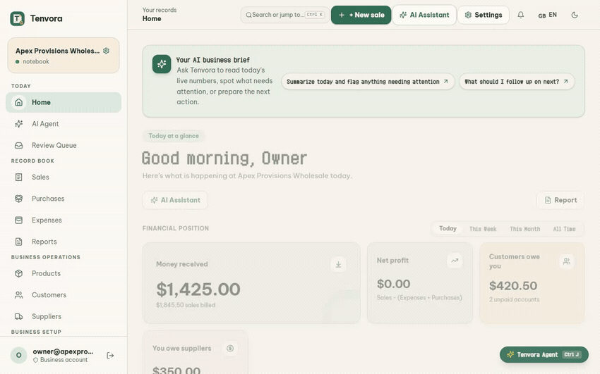
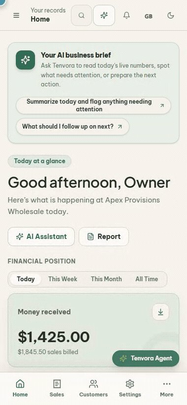

# Tenvora

<p align="center">
  
</p>

<p align="center">
  <strong>Deterministic Business Management & Ledger Platform for Local Enterprises</strong>
</p>

<p align="center">
  <a href="https://github.com/ttnhan227/Tenvora/actions/workflows/ci.yml"></a>
  <a href="https://github.com/ttnhan227/Tenvora/actions/workflows/build-mobile.yml"></a>
  
  
  
  
</p>

---

## 📌 Overview

**Tenvora** is a business-management system built for small and local businesses (retail, wholesale, supply shops). It replaces informal credit notebooks, scattered paper receipts, and manual spreadsheets with an append-only financial ledger, real-time debt tracking, and an integrated native mobile companion.

The architecture enforces strict mathematical invariants on the server: atomic transactions, advisory write locks for financial consistency, idempotency keys, non-negative inventory check constraints, immutable before/after audit snapshots, and defense-in-depth PostgreSQL Row-Level Security (RLS).

<p align="center">
  
</p>

---

## ✨ Key Features

* **📊 Practical Financial Dashboard:** Real-time visibility into today's sales, cash collections, categorized operating expenses, and net profit.
* **👥 Debt & Receivables Ledger:** Track customer and supplier debts, 1-click FIFO debt collection directly from customer lists, credit ceilings, and complete repayment histories.
* **🧾 Camera Receipt Capture:** Snap vendor invoices and store receipts directly from the mobile app to attach them to permanent records.
* **📱 Native Mobile Companion:** Lightweight Android app built with Flutter for fast 5-second counter sales and field operations.
* **🤖 Multi-Provider AI Copilot:** Grounded business analysis supporting configurable LLMs (Google Gemini, OpenAI, Mistral, Ollama, or custom OpenAI-compatible endpoints) with guarded, server-validated action proposals.
* **🔒 Tenant Scoping & RLS:** Global query filters on EF Core combined with PostgreSQL `FORCE ROW LEVEL SECURITY` session policies isolate data across all layers.
* **🌐 Multilingual & Multi-Currency Support:** Comprehensive web workspace with USD ($) primary currency and international localization (English and Vietnamese); native Android companion localized across 7 languages (EN, VI, ES, FR, DE, PT-BR, ID) with currency and date localization.

---

## 🏗️ Architecture & Technology

| Component | Stack | Responsibilities |
| :--- | :--- | :--- |
| **Web Frontend** | React 18, TypeScript, Vite, Tailwind CSS, TanStack Query | Web workspace, financial reports, catalog, store management. |
| **Backend API** | ASP.NET Core (.NET 10), Entity Framework Core, Npgsql | Ledger engine, atomic writes, advisory write locks, JWT auth. |
| **Database** | PostgreSQL 16+ / 18 (Supabase / Self-hosted / Neon) | Multi-tenant relational storage, check constraints, RLS policies, audit logs. |
| **Mobile App** | Flutter 3.x, Dart, Dio, Secure Storage | Android/iOS mobile client, camera receipt capture, offline token cache. |
| **AI Integration** | Multi-Provider LLM (`Gemini`, `OpenAI`, `Mistral`, `Ollama`, `Custom`) | Contextual chat, natural-language ledger queries, typed proposals. |
| **DevOps & CI/CD** | GitHub Actions, Docker, Render | Automated testing (314 tests: 187 .NET + 127 Vitest), Docker images, verified APK builds. |

---

## 📱 Mobile App (Android APK)

Pushes verify the backend, web workflows, PostgreSQL payments/recovery, and mobile tests, then build an APK as a GitHub Actions artifact. They do not publish an APK. When ready, run **Build & Release Mobile APK** manually with **publish** enabled; publication requires production signing secrets, an HTTPS backend URL, and the Google server client ID.

<p align="center">
  
</p>

* **Direct Download:** [Latest Android APK (`tenvora-mobile.apk`)](https://github.com/ttnhan227/Tenvora/releases/download/mobile-latest/tenvora-mobile.apk)
* **Release Channel:** [GitHub Releases (`mobile-latest`)](https://github.com/ttnhan227/Tenvora/releases/tag/mobile-latest)
* **In-App QR Install:** Navigate to `/mobile` on the web client to scan the QR code and download directly to any Android phone.

---

## 🚀 Quick Start (Local Development)

### Prerequisites
* [.NET 10 SDK](https://dotnet.microsoft.com/)
* [Node.js 22+](https://nodejs.org/) & `npm`
* [Docker Desktop](https://www.docker.com/) *(optional for containerized runs)*

### 1. Clone & Setup
```bash
git clone https://github.com/ttnhan227/Tenvora.git
cd Tenvora
cp .env.example .env
```
Configure your connection string and API keys in `.env`.

### 2. Fast Evaluation / Reviewer Walkthrough (Demo Mode)
To explore the system with a fully seeded store (*"Apex Provisions Wholesale"* / *"Tenvora Demo Retail"*), set:
```bash
SEED_DEMO_DATA=true
```
When started, the seeder automatically populates products, low-stock inventory alerts, customer receivables ($420.50), supplier payables ($350.00), posted sales ($1,845.50), and operating expenses ($210.00).
* **Demo Admin Email:** `owner@tenvora.internal`
* **Demo Admin Password:** `DemoPassword123!` (or value set in `SEED_ADMIN_PASSWORD`)

### 3. Run Locally

#### Option A: Native Hot-Reload (Recommended for Daily Coding)
Run the backend and frontend separately in two terminals:

```bash
# Terminal 1: Backend API (http://localhost:5000)
dotnet run --project server/Tenvora.Api.csproj

# Terminal 2: Web Client (http://localhost:5173)
cd client
npm install
npm run dev
```

#### Option B: Full Stack via Docker
```bash
docker compose up --build
```

---

## 🧪 Automated Testing & Verification

The codebase includes an extensive automated test suite enforcing ledger invariants, concurrency limits, and UI functionality:

```bash
# Run the unified verification pipeline (backend + frontend + lint + build):
pwsh scripts/verify-all.ps1        # Windows PowerShell
bash scripts/verify-all.sh         # Linux / macOS

# Or run individual test suites:
# Backend Tests (187 xUnit tests verifying ledger math, concurrency, and RLS)
dotnet test server.Tests

# Frontend Unit & Integration Tests (127 Vitest tests across 29 test suites)
npm --prefix client run test:run

# Frontend Linter & Production Build
npm --prefix client run lint
npm --prefix client run build
```

---

## 📂 Project Structure

```
Tenvora/
├── client/                 # React 18 + TypeScript frontend application
│   ├── src/
│   │   ├── components/     # UI components, modals, and design system
│   │   ├── contexts/       # Auth & Language (EN / VI) providers
│   │   ├── pages/          # Workspace pages and public landing page
│   │   └── services/       # Typed API clients & Axios interceptors
├── server/                 # ASP.NET Core (.NET 10) backend web API
│   ├── Controllers/        # REST endpoints (auth, sales, products, ai, etc.)
│   ├── Data/               # AppDbContext, migrations, audit interceptors
│   ├── Domain/Entities/    # Tenant-scoped domain models
│   └── Services/           # Ledger calculations, business rules, AI services
├── server.Tests/           # 187 xUnit unit, integration, and security regression tests
├── mobile/                 # Flutter mobile application
│   ├── lib/                # Mobile app code, camera receipts, state management
│   └── android/            # Native Android packaging & Gradle configuration
├── docs/                   # Production operations and Play Store compliance
│   ├── operations.md       # Deployment runbooks, database recovery, and health checks
│   └── google-play.md      # Store listing metadata, Data Safety, and compliance
└── .github/workflows/      # Automated CI/CD & Mobile release pipelines
    ├── ci.yml              # Tests and Docker images
    ├── verify-product.yml  # PostgreSQL, recovery, backend and browser checks
    ├── deploy-render.yml   # Manual Render deployment after verification
    └── build-mobile.yml    # APK verification; publication is explicitly selected
```

---

## ⚖️ Product Invariant

The relational database and deterministic application services are the ultimate source of truth. All financial calculations, partial payments, and ledger balances are computed exclusively on the server with decimal precision and idempotency protection.
