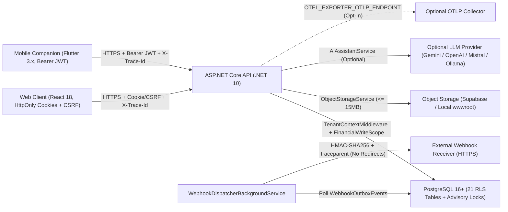
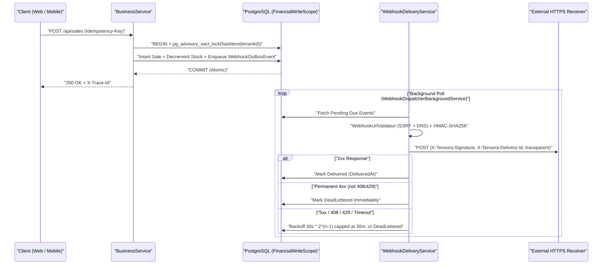

# Tenvora System Architecture

This document describes the system design, architectural trade-offs, concurrency controls, security boundaries, observability pipeline, and failure recovery behavior of **Tenvora**.

---

## 1. System Context & Component Architecture

Tenvora is a multi-tenant business ledger platform consisting of four primary subsystems:

- **Web Client (`client/`)**: React 18, TypeScript, Vite, TanStack Query, Tailwind CSS v4, Radix UI. Authenticates via `HttpOnly` cookies (`tenvora_access_token`, `tenvora_refresh_token`) paired with CSRF protection on unsafe HTTP methods.
- **Mobile Client (`mobile/`)**: Flutter 3.x (Android/iOS), Dio, Flutter Secure Storage. Authenticates via `Authorization: Bearer` JWT tokens for counter checkout and camera receipt capture.
- **Backend API (`server/`)**: ASP.NET Core (.NET 10), Entity Framework Core 10, Npgsql, OpenTelemetry, Swashbuckle. Owns all financial calculations, idempotency, transactional outbox writes, AI proposal state transitions, and authorization invariants.
- **Database & Object Storage**: PostgreSQL 16+ (primary relational ledger with `FORCE ROW LEVEL SECURITY` and check constraints) and Supabase Storage (with local `wwwroot` fallback in development via `ObjectStorageService`).

### Transactional Outbox & Webhook Delivery Flow

---

## 2. Key Architectural Decision Records (ADRs)

### ADR-01: Per-Tenant Advisory Write Locks & Deterministic Idempotency
- **Context:** Retail counter checkouts, FIFO customer account payments, and stock adjustments can arrive concurrently from multiple staff devices or retry on unstable mobile networks. Race conditions could otherwise cause negative stock or overpaid invoices.
- **Decision:** All financial mutations run inside `FinancialWriteScope.BeginAsync(db, tenantId)` (`server/Services/FinancialWriteScope.cs`), which opens (or reuses) a PostgreSQL transaction and acquires `pg_advisory_xact_lock(hashtext(tenantId))` before reading mutable balances or inventory. Write endpoints require a tenant-scoped `Idempotency-Key` paired with a SHA-256 `RequestHash` so exact retries return the original result while conflicting payloads fail deterministically.
- **Trade-offs & Known Limitations:** Serializing writes per tenant eliminates cross-row deadlocks and double-spend races for small/medium business workloads, but caps single-tenant write concurrency to one active financial transaction at a time. Horizontal scaling across API replicas remains safe because locking is enforced in PostgreSQL.

### ADR-02: Defense-in-Depth Multi-Tenant Isolation (Application Scoping + PostgreSQL RLS)
- **Context:** A missing `.Where(x => x.TenantId == tenantId)` predicate in any query could leak cross-tenant financial records.
- **Decision:** Every authenticated request passes through `TenantContextMiddleware` (`server/Middleware/TenantContextMiddleware.cs`), which pins an open PostgreSQL connection for the request, executes `SELECT set_config('app.current_tenant_id', $1, false)`, and unconditionally clears the setting using `CancellationToken.None` in `finally` before returning the connection to the pool. **21 tenant-scoped tables** enforce `ENABLE ROW LEVEL SECURITY` and `FORCE ROW LEVEL SECURITY` via EF Core migrations (`AddInventoryConstraintsAndTenantRls` [16 tables], `AddRlsToNewTenantTables` [3 tables], and `AddWebhookOutboxAndRls` [2 tables]).
- **Trade-offs & Known Limitations:** Pinning one open DB connection per authenticated request prevents connection-pool cross-talk but increases open connection lifetime for slow requests. In-memory EF Core unit tests bypass relational RLS; PostgreSQL-backed integration tests (`[PostgresFact]`) verify RLS enforcement directly against PostgreSQL 16.

### ADR-03: Dual-Client Authentication (Web Cookies + CSRF, Mobile Bearer JWT)
- **Context:** Browser clients are exposed to XSS token theft if JWTs are stored in `localStorage`, whereas native Flutter mobile clients require `Authorization: Bearer` headers backed by OS-level secure storage.
- **Decision:** `Program.cs` configures `JwtBearerEvents.OnMessageReceived` to accept either `Authorization: Bearer` headers or the `tenvora_access_token` `HttpOnly` cookie. Unsafe HTTP methods authenticated via cookies undergo CSRF origin/header validation in middleware, while Bearer-authenticated mobile requests bypass cookie CSRF checks.
- **Trade-offs & Known Limitations:** Maintaining two token transports requires explicit CORS credential policies (`CorsOriginPolicy`) and consistent logout/refresh cookie clearing.

### ADR-04: Two-Phase AI Copilot with Deterministic Service Execution
- **Context:** Allowing an LLM to directly mutate ledger tables introduces hallucination and financial integrity risks.
- **Decision:** `AiActionService` (`server/Services/AiActionService.cs`) splits AI-assisted mutations into `ProposeAsync` (creating an `AiAction` in `PendingConfirmation`) and `ConfirmAsync` (executing through deterministic `IBusinessService` methods inside `FinancialWriteScope`). Confirmed actions support `UndoAsync` (transitioning status to `Undone`, including payment reversal where applicable).
- **Trade-offs & Known Limitations:** Adds an explicit user confirmation step before any mutation occurs, trading one-shot automation for auditability and reversibility.

### ADR-05: Transactional Outbox for Outbound Webhooks
- **Context:** Calling external customer webhook URLs directly inside `BusinessService` transactions would hold PostgreSQL advisory locks across unpredictable network I/O and risk losing events on process crashes.
- **Decision:** `WebhookOutboxService.EnqueueAsync` (`server/Services/WebhookOutboxService.cs`) writes `WebhookOutboxEvent` rows inside the same `FinancialWriteScope` transaction as `sale.recorded`, `payment.received`, and `inventory.adjusted` (inserting zero rows when no active endpoint subscribes). `WebhookDispatcherBackgroundService` polls due rows out-of-band via `WebhookDeliveryService` (`server/Services/WebhookDeliveryService.cs`) with SSRF validation, HMAC-SHA256 signing, exponential backoff, DLQ, and `TenantAdmin` replay.
- **Trade-offs & Known Limitations:** Delivery is at-least-once rather than exactly-once; consumers must deduplicate using the stable `X-Tenvora-Delivery-Id` header. Polling introduces up to `PollIntervalSeconds` (default `5s`) latency between commit and delivery.

---

## 3. Data Integrity, Concurrency & Security Boundaries

| Boundary | Mechanism & Implementation |
| :--- | :--- |
| **Financial Consistency** | `FinancialWriteScope` (`pg_advisory_xact_lock`), `numeric(18,4)` precision, PostgreSQL `CHECK` constraints (`CK_Products_StockQuantity_NonNegative`, `CK_Sales_Total_Positive`, `CK_BusinessPayments_Amount_Positive`, `CK_StockAdjustments_NonNegativeAfter`, `CK_WebhookOutboxEvents_Status`). |
| **Idempotency** | Unique `(TenantId, IdempotencyKey)` indexes on `Sales`, `BusinessPayments`, `Purchases`, `PurchasePayments`, `BusinessExpenses`, and `AiActions`; deterministic SHA-256 `StockAdjustment` IDs; unique `(EndpointId, DeliveryId)` on `WebhookOutboxEvents`. |
| **Audit Trail & Redaction** | `AuditLogSaveChangesInterceptor` (`server/Data/Interceptors/AuditLogSaveChangesInterceptor.cs`) captures JSONB before/after snapshots while redacting `PasswordHash`, `ApiKey`, `InviteToken`, and `SigningSecret` and omitting inline base64 images. |
| **RBAC & Tenant Isolation** | `TenantAdmin` vs `OperationsManager` policies (`AdminOnly`, `OpsOrAdmin`). Webhook management (`/api/webhooks/*` in `WebhooksController`) is restricted to `[Authorize(Roles = "TenantAdmin")]`. `SigningSecret` is returned once on `POST /api/webhooks/endpoints` and masked to `SecretPrefix` on `GET`. |
| **Webhook SSRF & Signing** | `WebhookUrlValidator` (`server/Common/WebhookUrlValidator.cs`) requires `https://`, blocks embedded credentials, loopback, RFC1918, link-local/cloud metadata (`169.254.169.254`, `metadata.google.internal`), IPv6 ULA (`fc00::/7`), and private DNS resolutions. The `"TenvoraWebhooks"` `HttpClient` sets `AllowAutoRedirect = false` and a `10s` timeout. Payloads are signed with `WebhookSignature.Compute` (`t=<unix>,v1=<hmac_sha256>`) and verified via `CryptographicOperations.FixedTimeEquals`. |
| **Rate Limiting** | ASP.NET Core `AddRateLimiter` enforces fixed-window limits on `auth-rate-limit` (20 req/min per IP) and `payments-rate-limit` (120 req/min per user). |

---

## 4. Observability & Operational Readiness

- **Distributed Tracing (`server/Common/TenvoraTelemetry.cs`):** Registers OpenTelemetry `ActivitySource("tenvora-api", "1.0.0")` with ASP.NET Core, `HttpClient`, and `Npgsql.OpenTelemetry` instrumentation. OTLP export is strictly opt-in via `OTEL_EXPORTER_OTLP_ENDPOINT` or `OpenTelemetry:OtlpEndpoint`.
- **Trace Correlation (`server/Middleware/TraceCorrelationMiddleware.cs`):** Propagates incoming W3C `traceparent` headers and emits `X-Trace-Id` on every response (including `404` and `500`), exposed via CORS (`WithExposedHeaders("X-Trace-Id")`).
- **Custom Operational Spans (Non-PII Tags Only):**
  - `tenvora.financial_write_scope` (`db.system`, `tenvora.lock.acquired`, `tenvora.lock.reused_tx`, `tenvora.lock.wait_ms`)
  - `tenvora.ai.propose`, `tenvora.ai.confirm`, `tenvora.ai.undo` (`ai.intent`, `ai.action.status`)
  - `tenvora.webhook.deliver` (`webhook.event_type`, `webhook.attempt`, `webhook.status`, `http.status_code`, linked to the originating `TraceParent` captured at outbox enqueue time)
- **Operations & Recovery Runbooks:** See [docs/operations.md](./operations.md) for deployment health checks, database backup/restore verification, and operational procedures.

---

## 5. Failure Scenarios & Recovery Matrix

| Failure Mode | System Behavior | Safeguard / Recovery | Known Limit |
| :--- | :--- | :--- | :--- |
| **Concurrent counter checkout / double payment** | Second request blocks on `pg_advisory_xact_lock` until first commits, then sees updated stock/balance or matching `Idempotency-Key`. | Exact retry returns cached result; mismatched payload fails with 400; DB `CHECK` constraints prevent negative stock or overpayment. | Serializes writes per tenant while transaction is open. |
| **Webhook receiver returns `503` or times out** | `WebhookDeliveryService` increments `AttemptCount`, sets `Status = Pending`, and schedules `NextAttemptAt` with exponential backoff (`30s * 2^(n-1)`, capped at `30m`). | After `MaxAttempts` (default `5`), marks `DeadLettered`; `TenantAdmin` can inspect via `GET /api/webhooks/deliveries?status=DeadLettered` and replay via `POST /api/webhooks/deliveries/{id}/replay` preserving `DeliveryId`. | Consumers must handle at-least-once delivery idempotently. |
| **Webhook receiver returns permanent `400`/`404`/`410`** | Non-`408`/non-`429` `4xx` responses are treated as permanent client errors. | Immediately transitions to `DeadLettered` on attempt 1 without wasting retry budget; replayable after endpoint fix. | Requires operator action to correct receiver or endpoint configuration. |
| **SSRF or DNS rebinding attempt in webhook URL** | Rejected at `POST /api/webhooks/endpoints` by `WebhookUrlValidator` and re-validated at delivery time. | `AllowAutoRedirect = false` blocks 302 redirects to internal hosts; unsafe delivery-time resolutions dead-letter immediately. | DNS-to-connect TOCTOU window exists between resolution check and socket connect unless egress firewall rules also restrict RFC1918 ranges. |
| **Ephemeral container disk loss (receipts/images)** | Local `wwwroot` files are lost on container restart if cloud storage is unconfigured. | `ObjectStorageService` persists uploads (<= 15 MB) to Supabase Storage when `SUPABASE_STORAGE_URL` and key are configured, falling back to `wwwroot` only in local dev. | Local fallback is unsuitable for stateless multi-replica production deployments. |
| **AI action undo failure or partial state** | `AiActionService.UndoAsync` executes inside `FinancialWriteScope` and validates current state before reversing. | Failed undo leaves database transaction rolled back and preserves immutable `AuditLogs` for manual reconciliation. | Cannot undo external side effects (e.g., already-delivered webhooks). |
| **Tenant context setup failure on DB error** | `TenantContextMiddleware` fails closed with `503 Service Unavailable`. | `finally` block resets `app.current_tenant_id = ''` with `CancellationToken.None` and closes the connection so pooled connections never retain prior tenant state. | Requests fail closed when PostgreSQL is unreachable. |

---

## 6. Verified Engineering & Testing Evidence

### Automated Test Suites (Verified in Repository & CI)

| Suite | Command | Verified Coverage & Scope |
| :--- | :--- | :--- |
| **Backend (.NET 10 xUnit)** | `dotnet test Tenvora.sln -c Release` | **230 passed, 10 skipped** locally without PostgreSQL (`9` `[PostgresFact]` + `1` live AI test); **239 passed** in CI against PostgreSQL 16 (`verify-product.yml`), covering ledger math, concurrency/advisory locks, RLS, auth/CSRF, OpenTelemetry spans, and webhook reliability (`23` tests in `WebhookReliabilityTests`). |
| **Web Client (Vitest)** | `npm --prefix client run test:run` | **146 Vitest tests** across 34 test files covering UI workflows, localization, and API client behavior. |
| **Web E2E (Playwright)** | `npm --prefix client run test:e2e` | **11 Playwright specs** exercising authenticated browser flows and error states against the running stack. |
| **Mobile (Flutter)** | `docker compose --profile tools run --rm mobile-tools` | **66 Flutter tests** + `flutter analyze` executed via containerized toolchain and `build-mobile.yml`. |
| **Schema & RLS Integrity** | `AppDbContext_HasZeroPendingEfCoreModelChanges_RelativeToModelSnapshot` | Verified zero pending EF Core model drift across all 15 migrations and 21 RLS-protected tables. |

### Performance & Scale Benchmarks
- **Throughput, p99 latency, and sustained multi-tenant load:** **Not measured under production load.**
- **Recommended Benchmark Method:** Run `k6` or `Vegeta` against a dedicated PostgreSQL 16 + ASP.NET Core container with `OTEL_EXPORTER_OTLP_ENDPOINT` enabled, measuring single-tenant advisory-lock contention (`tenvora.lock.wait_ms`) and multi-tenant checkout throughput alongside webhook outbox poll drain rate.
